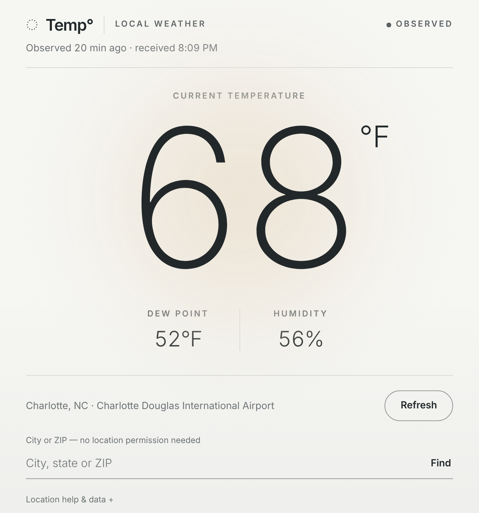

<p align="center"><sub>LOCAL WEATHER &nbsp;·&nbsp; NO ACCOUNT &nbsp;·&nbsp; NO SETUP</sub></p>

<h1 align="center">Temp°</h1>

<p align="center">Your local weather, large and readable.</p>

<p align="center"><a href="https://stewalexander-com.github.io/temp/"><b>Open the live app ↗</b></a></p>

<p align="center">
  <a href="https://stewalexander-com.github.io/temp/"></a>
</p>

<p align="center"><sub>Rendered from the app with sample data for Charlotte, NC. Not a live reading.</sub></p>

---

## One number. Read at a glance.

Temp° shows the temperature where you are, with dew point and humidity beneath it. Nothing to download, no account, nothing to configure.

<sub>USE IT</sub>

1. Open **[stewalexander-com.github.io/temp](https://stewalexander-com.github.io/temp/)**.
2. Enter a **city or ZIP**, tap **Find**, and choose your place. Or tap **Use device location** and allow access.
3. Read the temperature, dew point and humidity, plus heat index or wind chill when they apply.

After device location loads weather successfully, its button becomes **Refresh**. Tap it to request an updated location and reading.

Your selected city is remembered when browser storage is available. Weather updates every 15 minutes while the page is visible, and when you return to it or reconnect. Fresh weather requires internet access; cached readings are labeled.

## What you see.

| | |
|:--|:--|
| **Temperature** | Large Fahrenheit numerals. The air behind them is tinted by the temperature and spreads wider as humidity rises. |
| **Moisture** | Dew point and humidity. Heat index or wind chill when applicable. |
| **Rain, snow, storms** | One small mark in the header, only when something is falling or due within 30 minutes. Filled when the nearest station and the 15-minute model agree; outlined when only one says so. A time appears only when it has not started yet. |
| **Freshness** | Observation or forecast timestamps, with older readings clearly labeled. |
| **Warnings** | Active NWS warnings when available. Alert lookup is supplemental, not a comprehensive emergency notification service. |
| **Fallback** | A labeled Open-Meteo model estimate if NWS weather cannot be retrieved. |

The precipitation mark is an estimate, not a radar reading. The station may be miles from you and reports about hourly, and the model can miss or misplace a small shower. A blank header does not guarantee dry weather.

## Desktop, Facebook and home screens.

City selection works without device-location permission. If an embedded viewer blocks location, use the city search, or open the page in your regular browser through the viewer's menu.

For a home-screen shortcut, open the live app in Safari on iPhone or your browser on Android and use its **Add to Home Screen** option where available. Separate browsers and home-screen apps may require choosing your city or granting location permission again.

## Data and privacy.

City and ZIP searches go to [Open-Meteo ↗](https://open-meteo.com/) using GeoNames place data. Weather coordinates go to the National Weather Service and to Open-Meteo, which supplies the 15-minute rain and snow outlook and a fallback reading. The app saves your selected place and recent readings in this browser's local storage when available.

---

## Development.

This repository contains the running app. GitHub Pages publishes `docs/` from `main`. There is no build step.

| File | Role |
|:--|:--|
| `docs/index.html` | Interface and metadata |
| `docs/app.js` | Location selection, weather, refresh behavior, the halo tint and the precipitation mark |
| `docs/styles.css` | Responsive presentation |
| `docs/manifest.webmanifest`, icons | Home-screen metadata |
| `tests/location-flow.test.mjs` | 32 regression scenarios |

<sub>PREVIEW A CHECKOUT</sub>

```sh
python3 -m http.server 8000 --bind 127.0.0.1 --directory docs
```

Then open **http://localhost:8000/**.

<sub>RUN THE CHECKS</sub>

```sh
node --check docs/app.js
node tests/location-flow.test.mjs
```

See [the RCA and five hardening passes →](HARDENING.md) for evidence and testing limits. Desktop browser weather retrieval and responsive rendering were checked; physical Facebook/iPhone and installed home-screen behavior have not been directly verified.

## Project history.

[Export notes →](EXPORT-NOTES.md) describe the original version-27 export. `Temp-original-source-v27.zip` preserves that earlier server-backed implementation for reference; it is not required to use or run this app. Existing third-party license notices remain in that archive. No new project license is assigned here.

See the [sharing and home-screen review →](SHARING-REVIEW.md) for the three-pass audit, five-why RCA and platform verification limits.

---

<p align="center"><sub>A <a href="https://stewalexander.com">StewAlexander.com ↗</a> project &nbsp;·&nbsp; Ideas · research · tools</sub></p>
